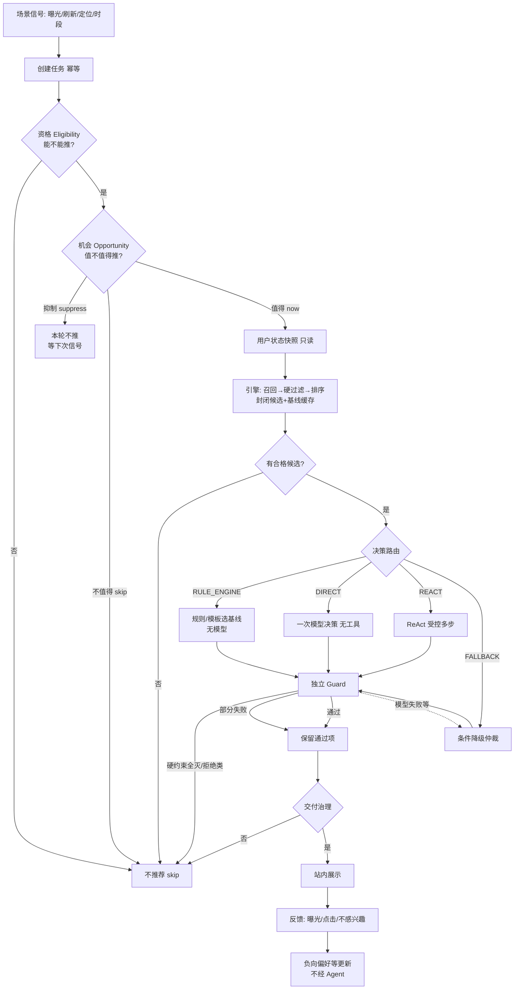

# 主动推荐 Agent 技术方案

版本 1.5（架构评审修订版 · 系统设计，代码未落地）

配套：[`架构图.html`](./架构图.html) · [`架构评审-v1.5.md`](./架构评审-v1.5.md)

---

## 0. 修订摘要（相对 v1.4）

| 变更 | 原因 |
| --- | --- |
| 新增 **机会判断 Opportunity**（与资格 Eligibility 分离） | 原方案能挡「不能推」，弱于「值不值得推」 |
| 路由表改为 **可编码条件** | 原 DIRECT/REACT 条件偏示例，无法直接实现 |
| 明确 **Agent 增益验收** | 防止 Agent 退化成文案层 |
| 冻结 **MVP 用户状态模型** 与反馈语义 | 长短期冲突、过期、负反馈可测试 |
| 多样性：**引擎粗控 + Guard 终裁** | 职责清晰 |
| 评测强制 **三臂对照**（引擎 / DIRECT / REACT） | 证明 Agent 价值 |
| 代码结构允许合并，逻辑分层保留 | 降低第一版落地成本 |
| 未改：封闭候选、工具白名单、Guard 硬约束优先、条件降级、生成≠交付 | 仍正确 |

参数类数字凡无业务依据的，标 **待验证**，不编造收益。

---

## 1. 目标与非目标

### 1.1 目标

在用户**未搜索、未对话**时，系统能：

1. 判断**现在是否值得**主动推荐（机会）；  
2. 在允许的前提下，用引擎给出封闭候选；  
3. 在确有必要时，用 Agent（直接一次决策或受控 ReAct）分析、补证据、选择并写有依据的理由；  
4. 经独立校验与交付治理后展示；  
5. 用数据证明相对纯引擎是否有增益，且成本可控。

推荐形态：以**商家**为主，每家关联 **1–3** 个商品。

### 1.2 三个决策必须分开

| 决策 | 问题 | 负责方 |
| --- | --- | --- |
| **主动决策** | 现在要不要发起/继续这次推荐？ | 资格 + 机会策略（规则） |
| **推荐决策** | 推哪些商家/商品、理由是什么？ | 引擎 +（可选）Agent |
| **交付决策** | 算出来的结果能不能给用户看？ | Guard + 交付治理 |

### 1.3 第一版非目标

用户对话、发券、真实订单库、在线学习、多渠道 Push 平台、多 Agent 协作、预期收益机器学习模型、复杂长期记忆。站内展示 + 本地样例即可。

---

## 2. 整体架构

### 2.1 流程（含正常 / 抑制 / 失败 / 降级）



### 2.2 模块职责

| 逻辑模块 | 职责 | 第一版代码建议 |
| --- | --- | --- |
| 任务与幂等 | 去重建任务 | `api` + `store` |
| 资格 Eligibility | 授权、免打扰、频控、冷却、场景有效 | `policy.py` 一节 |
| 机会 Opportunity | 值不值得推；suppress/skip/now | 同上 |
| 用户快照 | 只读组装 | `snapshot.py` |
| 推荐引擎 | 召回过滤排序基线 | `engine.py` |
| 路由 | 可编码模式选择 | `policy.py` |
| Agent Runtime | DIRECT/REACT 循环、工具、预算 | `runtime/` |
| Guard | 硬/质量/业务 + 仲裁 | `runtime/guard.py` |
| 交付 | 展示前再验 | `policy.py` |
| 反馈与评测 | 反馈写入、三臂离线评测 | `feedback` + `eval` |

---

## 3. 主动决策：资格 + 机会

### 3.1 资格 Eligibility（能不能推）

任一失败 → `skip`，不跑引擎与模型。

| 检查 | 失败码 |
| --- | --- |
| 未开个性化 | `not_authorized` |
| 免打扰时段 | `dnd_window` |
| 频次超限 | `freq_cap` |
| 冷却未结束 | `cooldown` |
| 场景无效 | `invalid_scene` |
| 幂等已成功 | 返回旧任务 |
| 用户关闭该类 | `category_opt_out` |

频次、冷却、免打扰的**具体数字：待确认**。

### 3.2 机会 Opportunity（值不值得推）· v1.5 新增

资格通过后执行。输出三种之一：

| 结果 | 含义 | 第一版典型条件（规则，可测） |
| --- | --- | --- |
| `recommend_now` | 本轮继续引擎+后续 | 场景有效且未命中下方抑制 |
| `suppress` | 本轮不推，不调模型；等下次触发 | 见下表 |
| `skip` | 明确不推荐 | 无可用信号且策略要求跳过（少用） |

**第一版抑制规则（建议全部实现，阈值待确认）：**

| 信号 | 行为 |
| --- | --- |
| 冷却窗内已成功展示过**高度相似**推荐（同商家或同类目） | `suppress` |
| 用户对某商家/类目刚 `not_interested`（在有效期内） | 后续硬过滤；若会导致「几乎无候选」可直接 `suppress` |
| 刚发生转化/下单同类（样例里用种子事件模拟） | `suppress` |
| 短间隔内重复同一 `trigger+粗粒度场景` | 幂等或 `suppress` |
| 引擎尚未跑时无法知候选质量 | 机会阶段**不**用模型估收益；候选过弱在引擎后 `skip` |

**第一版不做：** `delay` 定时器、`wait_new_signal` 长等待、多 Agent 规划、学习型收益模型。用「suppress + 下次场景再触发」近似延迟。

### 3.3 事件风暴防护

- 幂等键：`tenant + user + trigger + scene_id`（或等价）。  
- 同用户全局冷却（资格）+ 相似推荐抑制（机会）。  
- 路由优先 RULE_ENGINE / DIRECT，避免无缺口进 REACT。

---

## 4. 用户状态模型（MVP）

Agent **只读**快照，**不得**改画像。画像/负向更新由反馈管道独立完成。

### 4.1 快照结构

```text
UserSnapshot
  identity: user_id, tenant_id, snapshot_version, built_at
  profile: 城市, 会员, new|active|dormant, 常在商圈
  long_term: 类目偏好与分数, 客单价区间, 常点商家  # 带 updated_at
  short_term: 规则信号列表  # browse_burst / compare_burst / cart_or_order_gap
              每项: topic, confidence, updated_at, expires_at, source
  hard_constraints: 忌口, 拉黑商家, 不感兴趣商家(含 expires_at), 价格带
  recent_feedback_summary: 近 N 次曝光/点击/不感兴趣摘要（供去重，非改长期）
```

### 4.2 冲突与可信度（可编码）

| 规则 | 说明 |
| --- | --- |
| 硬约束永远优先 | 忌口/拉黑/不感兴趣不可被短期兴趣覆盖 |
| 短期 vs 长期（软） | 未过期的短期信号用于**偏置**排序与路由「冲突」标志；不写回长期 |
| 过期 | `expires_at` 已过的短期信号与负向项不进入快照 |
| 单次行为 | 一次点击 ≠ 改长期；`not_interested` → 负向列表（TTL **待确认**，文档曾写 30 天作初值） |
| 曝光 | 只用于去重/频控，不表示喜欢 |
| 点击 | 软正信号，仅进短期摘要 |
| 购买/转化 | 第一版用种子模拟；触发机会抑制 |

无对话式意图识别；「意图」= 场景字段 + 短期规则信号。

---

## 5. 推荐引擎与质量目标

### 5.1 引擎职责

四路召回 → 硬过滤 → 排序 → 封闭候选（约 ≤30）+ **已硬过滤基线缓存**。

商家主、商品从属：候选结构必须带 `merchant_id` 与下属 `product_id`；Guard 校验归属。

### 5.2 第一版优化目标（定性，无编造权重）

| 类型 | 内容 |
| --- | --- |
| **不可违反** | 硬过滤全集合；商品属于商家；证据未过期；资格/交付通过 |
| **优化方向** | 场景与长短期相关；名单不过度同类；理由可核对 |
| **不优化** | 单纯理由文采；单纯模型自报分 |

多样性：引擎 Top 池粗控；**最终名单同类目商家 ≤2 由 Guard 终裁**（是否全场景一刀切：**待确认**）。

### 5.3 Agent 不得承担的引擎工作

不算协同分、不扫全库、不负责首次大规模召回（补充召回除外且受控）。

---

## 6. 决策路由（可编码）

输入：资格与机会已通过；引擎输出 `candidates`、`baseline`、`facts_complete`、`intent_conflict`、`need_freshness`、`candidate_count`、`budget_ok`。

| 模式 | 条件（全部满足才入） | 行为 |
| --- | --- | --- |
| **SKIP** | 无合格候选；或机会/资格已否 | 不推荐 |
| **FALLBACK** | `budget_ok=false` 或依赖熔断，且存在基线 | 不进模型；条件降级 |
| **RULE_ENGINE** | `facts_complete=true` 且 `intent_conflict=false` 且 `need_freshness=false` 且策略允许无模型 | 基线截断 + **模板理由**（引用候选特征证据），无 LLM |
| **DIRECT** | `facts_complete=true` 且无冲突/无新鲜度缺口，但需要自然语言理由或轻量重排说明 | **一次**模型调用；**禁止工具** |
| **REACT** | 存在以下任一：`intent_conflict`；`need_freshness`；需对比才能决；过滤后过少需补充召回 | ReAct；补充召回最多 1 次 |

字段定义（实现时用规则算布尔，阈值待验证）：

- `facts_complete`：展示所需关键字段（营业、距离、价格带、库存摘要）均有未过期证据。  
- `intent_conflict`：最高置信未过期短期类目 ≠ 排序第一商家类目。  
- `need_freshness`：关键证据将过期或缺失。  
- `budget_ok`：距 `deadline_at` 仍够一次模型（或一轮工具+模型）。

**原则：** 无缺口不进 REACT；能 RULE_ENGINE 就不强制 DIRECT。

---

## 7. Agent 核心机制

### 7.1 工具白名单（同前，受控）

`get_merchant_detail` · `get_product_detail` · `compare_candidates` · `get_exposure_history` · `supplement_recall`（≤1，bump 候选版本）· `submit_recommendation`（幂等终止）。

### 7.2 何时允许补充召回

仅 REACT，且 `candidate_count` 过低或过滤后为空前曾有场景可放宽，策略∈{widen_radius, adjacent_category, trending}；**必须再硬过滤**；旧证据不可挂新 ID。

### 7.3 结束条件

- 成功 `submit` 且 Guard 通过（或质量层剔除后仍≥1 家）。  
- 预算耗尽 → 仲裁。  
- 协议连续失败 → 仲裁。  
- submit 校验同一原因连续两次失败 → 仲裁。

### 7.4 Agent 增益验收（评测用，P0）

对标记为「应体现 Agent 价值」的用例，至少一条：

- **选择变化：** 最终商家集合 ≠ 纯引擎基线截断；或  
- **证据增量：** 理由引用了引擎首屏压缩特征中不存在、而由工具观察写入的证据。

仅改写文案、选择与基线完全一致且无新证据 → 该用例记 **Agent 无增益**（用于改进提示/路由，不是生产硬阻断除非产品要求）。

---

## 8. 可靠性：校验、降级、交付

### 8.1 第一版安全底线（必须）

1. 封闭候选集；工具白名单；租户注入。  
2. 硬约束失败不可输出、不可降级绕过拒绝类。  
3. 证据索引含过期；候选版本变更后旧证据不可用。  
4. submit 幂等；交付前再验。  
5. 生成 ≠ 展示。  
6. 全链路 `deadline_at`（初值约 20s：**待验证**）。

### 8.2 Guard

硬约束阻断条目 → 质量可修正/剔除 → 业务裁剪 → 仲裁。  
部分失败：保留通过项。全灭或拒绝类：不推荐。

### 8.3 条件降级

模型不可用等 → 仅当存在**硬约束通过**的基线且资格仍有效 → 输出子集并标 `ranker_fallback`。  
禁止：未校验 Top3 直出；禁止绕过不感兴趣/忌口。

### 8.4 后续可完善（非 P0）

细粒度工具熔断矩阵、多渠道投递状态机、学习型校准自报分。

---

## 9. 效果闭环与验证

### 9.1 三层指标（无编造达标线）

- **系统：** 延迟、模型调用率、工具调用率、超时/降级率、单次成本。  
- **推荐：** 约束遵守、事实对齐、多样性、点击/转化（样例阶段可用代理标签）、理由证据率。  
- **触达：** 负反馈、重复曝光、抑制是否命中、无效打扰（应 skip/suppress 却展示）→ 目标趋向 0。

点击率**不是**唯一成功标准。

### 9.2 三臂对照（第一版必须）

同一批固定用例离线跑：

1. **Engine**：纯引擎基线 + 模板理由（或无理由）。  
2. **DIRECT**：引擎 + 一次模型。  
3. **REACT**：引擎 + ReAct（仅路由为 REACT 的子集用例强制走 REACT）。

报告：约束遵守率、Agent 增益率、模型调用次数、降级率。线上小流量 **待具备数据后**；成功阈值 **待确定**。

### 9.3 归因注意

用例标签区分：触发/机会问题、候选质量问题、Agent 决策问题、交付误杀——避免把引擎差归咎于 Agent。

---

## 10. 第一版 MVP

### 10.1 做 / 不做

**做：** 资格+机会、快照、引擎、可编码路由、DIRECT+REACT、白名单工具、Guard、交付、反馈负向、结构化 Trace、三臂离线评测、站内展示页。  

**不做：** Push 平台、发券、在线学习、delay 调度、多 Agent、真实订单、微服务拆分。

### 10.2 目录（单体）

```text
mini_agent/
  policy.py          # eligibility + opportunity + router + delivery
  snapshot.py
  engine.py
  runtime/
    loop.py
    registry.py
    guard.py
    trace.py
  tools.py
  feedback.py
  store.py
  api.py
  web/
  eval/
    cases.json
    runner.py
  docs/
```

### 10.3 关键状态

`pending → running → succeeded | degraded | suppressed | skipped | empty | failed`

### 10.4 关键接口

- `POST /v1/recommendation-tasks`  
- `GET /v1/recommendation-tasks/{id}`  
- `GET /v1/recommendation-tasks/{id}/trace`  
- `POST /v1/recommendations/{id}/feedback`  

### 10.5 Trace 必填字段

`run_id, route_mode, opportunity_result, decision_reason_code, tool_name, result_status, evidence_ids, guard_results, fallback_reason, latency_ms, model_calls`

---

## 11. 验证计划

| 阶段 | 目标 | 主要内容 | 通过条件 |
| --- | --- | --- | --- |
| 1 硬约束单测 | 安全底线 | 忌口/拉黑/不感兴趣/越权 ID/归属 | 违规必阻断；**通过=0 漏放** |
| 2 路由与工具 | 行为符合表 | 冲突→REACT；齐全→RULE/DIRECT；补召回≤1 | 断言模式与工具次数 |
| 3 异常降级 | 失败可预期 | 超时、协议失败、校验双失败、模型不可用 | 降级仍过硬约束；拒绝类不绕过 |
| 4 固定样例离线 | 质量与增益 | 四人设+边界用例；人工抽查理由 | 约束遵守率 100%（硬约束）；增益定义见 7.4；业务命中阈值 **待确定** |
| 5 三臂对比 | Agent 价值 | Engine vs DIRECT vs REACT | 输出对照表；若 REACT 无增益且成本高→改路由而非强上 |
| 6 站内小流量 | 触达健康 | 有真实行为后再做 | 指标与门禁 **待确定** |

---

## 12. 待确认 / 待验证

| 项 | 状态 |
| --- | --- |
| 频控、冷却、免打扰、负向 TTL、相似抑制窗 | 待确认 |
| 任务超时、步数、工具超时初值 | 待验证 |
| 同类目≤2 是否全场景 | 待确认 |
| 模型自报分展示阈值 | 不得单独放行；阈值待定 |
| 线上实验成功线 | 待确定 |
| 机会规则是否增加「候选预估过弱」前置 | 待验证（现放在引擎后 skip） |

---

## 13. 落地顺序

1. 引擎硬过滤 + 基线缓存 + 硬约束测试  
2. 资格 + 机会 + 幂等  
3. 路由表布尔特征 + RULE_ENGINE  
4. DIRECT → Guard → 交付  
5. REACT 工具与补召回  
6. 反馈负向  
7. 三臂评测与 Trace 面板  

---

**最终标准自检：**  
能在合适时机判断是否值得主动推荐；必要时用受控 Agent 提升选择或证据质量；任何路径不突破用户与业务硬约束；并能用三臂评测说明 Agent 是否带来可测量收益且成本可控。
