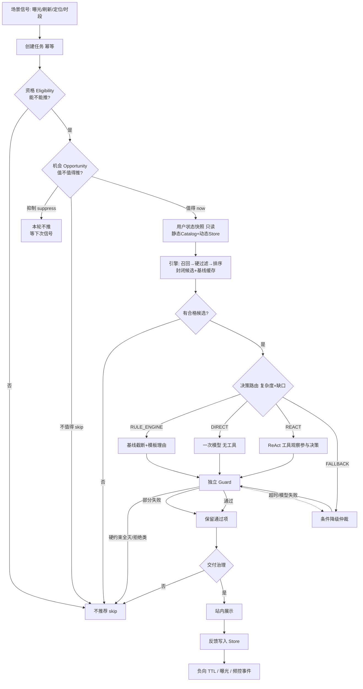

# 主动推荐 Agent 技术方案

版本 1.6（架构缺陷修复版 · 单体 MVP + Mock LLM）

配套：[`架构图.html`](./架构图.html) · [`架构评审-v1.5.md`](./架构评审-v1.5.md)

---

## 0. 修订摘要

### 0.1 相对 v1.5（本版重点）

| 变更 | 原因 |
| --- | --- |
| **动态用户状态统一归属 Store** | 进程内存 / Catalog 混写导致重启丢失、频控与曝光语义纠缠 |
| 拆分 **频控 / 场景去重 / 曝光历史**，曝光返回**真实商家 ID** + 时间窗 | 原 `recent_impressions` 塞 scene_id，无法做真实去重与工具观察 |
| **`deadline_at` 贯穿**模型与工具调用前预算检查 | 仅路由入口算一次 `budget_ok`，执行中仍可能超时硬跑 |
| **Guard** 补齐证据存在、归属、版本、时效；商家/商品事实分袋 | 价格混用、格式绕过、补召回后旧证据挂新 ID |
| **三档路由**按决策复杂度 + 证据缺口；工具观察必须参与决策 | DIRECT / 补召回难触达；REACT 常为「制造分支」 |
| **统一评测链路** + **规则重排基线**；区分选择变化 / 质量收益 | 各臂旁路实现，增益口径含糊 |
| **统一 UTC**（存储与比较一律 UTC；展示可转本地） | 混用 `+08:00` 与 naive 导致窗判断漂移 |

### 0.2 相对 v1.4 仍保留

机会与资格分离、封闭候选、工具白名单、Guard 硬约束优先、条件降级、生成≠交付、Agent 增益验收概念。

参数类数字凡无业务依据的，标 **待验证**，不编造收益。

---

## 1. 目标与非目标

### 1.1 目标

在用户**未搜索、未对话**时，系统能：

1. 判断**现在是否值得**主动推荐（机会）；  
2. 在允许的前提下，用引擎给出封闭候选；  
3. 在确有必要时，用 Agent（直接一次决策或受控 ReAct）分析、补证据、选择并写有依据的理由；  
4. 经独立校验与交付治理后展示；  
5. 用数据证明相对纯引擎 / 规则重排是否有增益，且成本可控。

推荐形态：以**商家**为主，每家关联 **1–3** 个商品。

### 1.2 三个决策必须分开

| 决策 | 问题 | 负责方 |
| --- | --- | --- |
| **主动决策** | 现在要不要发起/继续这次推荐？ | 资格 + 机会策略（规则） |
| **推荐决策** | 推哪些商家/商品、理由是什么？ | 引擎 +（可选）Agent |
| **交付决策** | 算出来的结果能不能给用户看？ | Guard + 交付治理 |

### 1.3 第一版非目标

用户对话、发券、真实订单库、在线学习、多渠道 Push 平台、多 Agent 协作、预期收益机器学习模型、复杂长期记忆。站内展示 + 本地样例即可。保留**单体**与 **Mock LLM**。

---

## 2. 整体架构

### 2.1 流程（含正常 / 抑制 / 失败 / 降级）



### 2.2 模块职责

| 逻辑模块 | 职责 | 代码 |
| --- | --- | --- |
| 任务与幂等 | 去重建任务 | `api` + `store` |
| **动态状态 Store** | 反馈 TTL、频控、场景去重、曝光（商家 ID）、交付摘要 | `store.py` |
| 资格 / 机会 / 路由 / 交付 | 确定性策略 | `policy.py` |
| 用户快照 | 只读组装：Catalog 静态 ⊕ Store 动态 | `snapshot.py` |
| 推荐引擎 | 召回过滤排序基线 | `engine.py` |
| Agent Runtime | DIRECT/REACT、工具、**deadline 预算** | `runtime/` |
| Guard | 证据存在/归属/版本/时效 + 商家商品分袋事实 | `runtime/guard.py` |
| 反馈 | 只写 Store，不经 Agent | `feedback.py` |
| 评测 | 统一服务链路；Engine / RuleRerank / DIRECT / REACT | `eval/` |

### 2.3 时间约定

- 存储、TTL、频控窗、证据过期、deadline **一律 UTC**（ISO-8601，后缀 `Z` 或 `+00:00`）。  
- 场景入参若带偏移，先规范为 UTC 再比较。  
- 免打扰按场景本地墙钟小时解释时，先用场景自带时区取 hour，再与配置比较（配置仍为「用户本地习惯小时」假设）。

---

## 3. 主动决策：资格 + 机会

### 3.1 资格 Eligibility

任一失败 → `skip`，不跑引擎与模型。

| 检查 | 失败码 | 数据来源 |
| --- | --- | --- |
| 未开个性化 | `not_authorized` | Catalog 静态 |
| 免打扰时段 | `dnd_window` | 场景时间 |
| **频次超限（时间窗）** | `freq_cap` | Store：窗内成功交付次数 |
| 冷却未结束 | `cooldown` | Store：`last_success_at` |
| 场景无效 | `invalid_scene` | 场景 |
| 幂等已成功 | 返回旧任务 | Store tasks |
| 用户关闭该类 | `category_opt_out` | Catalog 静态 |

频次、冷却、免打扰数字：**待确认**（可配置）。

### 3.2 机会 Opportunity

| 结果 | 含义 |
| --- | --- |
| `recommend_now` | 继续引擎+后续 |
| `suppress` | 本轮不推，不调模型 |
| `skip` | 明确不推荐（少用） |

| 信号 | 行为 | 数据 |
| --- | --- | --- |
| **场景去重**（与频控分离） | 同 `user+trigger+scene_id` 在去重窗内已见 → `suppress` | Store `scene_seen` |
| 相似推荐（同商家/同类目，抑制窗内） | `suppress` | Store 最近交付摘要 |
| `not_interested` 有效期内 | 硬过滤；候选将空时可 `suppress` | Store + TTL |
| 近期转化 | `suppress` | Store / 种子 |
| 候选质量 | 机会阶段不用模型；引擎后 `empty` | — |

### 3.3 事件风暴防护

- 幂等键：`tenant + user + trigger + scene_id`。  
- 资格频控（交付计数）≠ 机会场景去重 ≠ 曝光历史查询。  
- 路由：无缺口不进 REACT；能 RULE 不强制 DIRECT。

---

## 4. 用户状态模型（MVP）

Agent **只读**快照，**不得**改画像。动态写入只走反馈 / 交付管道 → **Store**。

### 4.1 静态 vs 动态

| 层 | 归属 | 内容 |
| --- | --- | --- |
| 静态画像 | `fixtures` → Catalog | 城市、会员、长短期种子、忌口、拉黑、价格带、授权 |
| 动态状态 | **Store** | `not_interested`(expires_at)、交付成功、场景已见、曝光/点击事件 |

### 4.2 快照结构

```text
UserSnapshot  # 只读视图，built_at=UTC
  identity / profile / long_term / short_term(未过期)
  hard_constraints: 忌口, 拉黑,
    not_interested_merchants  # = 静态种子 ∪ Store 未过期动态
  runtime_signals:          # 由 Store 注入，供资格/机会/工具
    delivery_count_in_window
    last_success_at
    recent_shown_merchants / categories
    scene_seen_recently(bool)  # 针对当前 scene，组装时计算
    exposure_merchant_ids[]    # 时间窗内真实商家 ID
```

### 4.3 冲突与可信度

| 规则 | 说明 |
| --- | --- |
| 硬约束永远优先 | 忌口/拉黑/未过期不感兴趣不可被短期覆盖 |
| 短期 vs 长期 | 未过期短期仅偏置排序与路由；不写回长期 |
| 过期 | `expires_at`（UTC）已过不进快照 |
| `not_interested` | Store 持久化 + TTL（初值 30 天：**待确认**） |
| 曝光 | 只去重/频控/工具历史，不表示喜欢；**必须带 merchant_id** |
| 点击 | 软正信号，进 Store，不改长期 |
| 转化 | 种子或 Store 事件 → 机会抑制 |

---

## 5. 推荐引擎与质量目标

### 5.1 引擎职责

四路召回 → 硬过滤 → 排序 → 封闭候选（≤30）+ 已硬过滤基线。候选带 `merchant_id` / `product_id` / `evidence_id` / `expires_at`(UTC) / 归属 `candidate_set_version`。

### 5.2 不可违反

硬过滤全集；商品属于商家；证据未过期且版本匹配；资格/交付通过。

多样性：引擎粗控；**最终同类目商家 ≤2 由 Guard 终裁**（是否全场景：**待确认**）。

### 5.3 Agent 不做

不算协同分、不扫全库、不负责首次大规模召回（补充召回除外且受控）。

---

## 6. 决策路由（三档 · 复杂度 + 证据缺口）

输入：`candidates`、`baseline`、`facts_complete`、`intent_conflict`、`need_freshness`、`need_compare`、`soft_rerank`、`candidate_count`、`budget_ok`、`supplement_needed`。

| 模式 | 复杂度 | 进入条件（全部） | 行为 |
| --- | --- | --- | --- |
| **SKIP** | — | 无合格候选 | 不推荐 |
| **FALLBACK** | — | `budget_ok=false` 或依赖熔断，且有基线 | 不进模型；条件降级 |
| **RULE_ENGINE** | 低 | 事实齐全 ∧ ¬冲突 ∧ ¬新鲜度缺口 ∧ ¬需对比 ∧ ¬soft_rerank ∧ ¬需补召回 | 基线截断 + 模板理由 |
| **DIRECT** | 中 | 事实齐全 ∧ ¬冲突 ∧ ¬新鲜度缺口 ∧ ¬需对比 ∧ ¬需补召回 ∧ **soft_rerank**（轻量重排/自然语言理由，**禁止工具**） | 一次模型 |
| **REACT** | 高 | 下列任一：`intent_conflict`；`need_freshness`；`need_compare`；`supplement_needed`（候选过少） | ReAct；补召回 ≤1；**工具观察必须改变选择或证据引用** |

字段（规则算布尔，阈值待验证）：

- `facts_complete`：营业、距离、价格带、库存摘要均有未过期证据。  
- `intent_conflict`：最高置信未过期短期类目 ≠ 排序第一商家类目。  
- `need_freshness`：关键证据将过期或缺失。  
- `need_compare`：存在短期类目对手商家且与引擎头名不同。  
- `soft_rerank`：无硬冲突，但偏好标签/生命周期需要轻量重排或自然语言理由（使 DIRECT 可达）。  
- `supplement_needed`：`candidate_count < supplement_min`（初值待验证，建议 3）。  
- `budget_ok`：距 `deadline_at` 仍够**下一次**模型或（工具+模型）最小预算。

**原则：** 不为「调用 Agent」人为制造 REACT；无工具缺口不进 REACT；能 RULE 不强制 DIRECT。

---

## 7. Agent 核心机制

### 7.1 工具白名单

`get_merchant_detail` · `get_product_detail` · `compare_candidates` · `get_exposure_history`（**返回窗内真实 merchant_id**）· `supplement_recall`（≤1，bump 版本）· `submit_recommendation`。

### 7.2 预算与 deadline

- 任务创建时设定 `deadline_at`（UTC，初值约 20s：**待验证**）。  
- **每次**模型调用前、**每次**工具调用前检查剩余预算；不足 → 立即仲裁降级，不得继续调用。  
- 降级仅输出**已过硬约束**的基线子集，标 `ranker_fallback` / `deadline_exhausted`。

### 7.3 工具观察参与决策

- `compare_candidates` 结果必须用于最终排序或商家取舍，并在理由中引用其 `evidence_id`。  
- `supplement_recall` 合并新候选后，选择必须可落在新集合；旧版本证据不可挂新 ID。  
- 仅调用工具但选择与无工具时完全一致且无新证据引用 → 评测记 **无质量收益**（见 9.2）。

### 7.4 结束条件

成功 submit 且 Guard 通过（或质量剔除后仍≥1）；预算耗尽 → 仲裁；协议连续失败 → 仲裁；submit 同一原因连续两次失败 → 仲裁。

### 7.5 Agent 增益验收（评测）

对标记用例，分别报告：

- **选择变化（selection_change）：** 最终商家集合 ≠ 引擎基线截断，且 ≠ 规则重排基线（若有）。  
- **质量收益（quality_gain）：** 理由引用了工具观察写入、且引擎首屏压缩特征中不存在的证据。  

仅改文案、选择不变且无新证据 → **Agent 无增益**。

---

## 8. 可靠性：校验、降级、交付

### 8.1 安全底线

1. 封闭候选；工具白名单；租户注入。  
2. 硬约束失败不可输出、不可降级绕过拒绝类。  
3. 证据索引含过期与 **candidate_set_version**；版本变更后旧证据不可用。  
4. submit 幂等；交付前再验。  
5. 生成 ≠ 展示。  
6. 全链路 `deadline_at` 执行期强制检查。

### 8.2 Guard（强化）

对每条商家 / 商品：

| 检查 | 失败语义 |
| --- | --- |
| 证据 ID 存在于索引 | 硬失败剔除 |
| 证据 **归属** 该商家或该商品（subject 匹配） | 硬失败 |
| 证据 **版本** = 当前 `candidate_set_version`（工具批证据跟提交时版本） | 硬失败 |
| 证据 **时效** `expires_at` > now(UTC)（无过期字段的快照类除外） | 硬失败 |
| 商家理由事实袋 | 只允许 `avg_price` / `distance_m` / `is_open` / `category` 等商家字段 |
| 商品理由事实袋 | 只允许 `price` / `in_stock` 等商品字段 |
| **禁止**商家理由用商品 `price` 或商品理由用 `avg_price` 混校 | `reason_fact_mismatch:price_bag` |
| 数字格式 | 须带明确单位（`元`/`米`）；拒绝无单位裸数字充当价格/距离绕过 |

流程：硬约束阻断 → 质量剔除 → 业务多样性裁剪 → 仲裁。部分失败保留通过项。

### 8.3 条件降级

超时 / 模型不可用 → 仅当存在硬约束通过的基线且资格仍有效 → 子集 + `ranker_fallback`。禁止未校验 Top3 直出；禁止绕过不感兴趣/忌口。

---

## 9. 效果闭环与验证

### 9.1 三层指标

系统：延迟、模型/工具调用率、超时降级率。  
推荐：约束遵守、事实对齐、多样性、理由证据率。  
触达：负反馈、重复曝光、抑制命中、无效打扰 → 趋向 0。

### 9.2 统一评测链路（必须）

**同一** `RecommendationService`（或等价编排）离线跑，禁止各臂复制半套逻辑。臂：

1. **Engine**：强制 RULE_ENGINE（纯引擎基线 + 模板理由）。  
2. **RuleRerank**：无模型；按短期/偏好规则重排基线 + 模板理由（证明「非 LLM 重排」上限）。  
3. **DIRECT**：强制或自然路由到 DIRECT。  
4. **REACT**：强制或自然路由到 REACT。

报告字段：`selection_change`、`quality_gain`、模型次数、降级率、约束遵守。  
线上小流量：**待具备数据后**。

### 9.3 归因

用例标签区分：触发/机会、候选质量、Agent 决策、交付误杀。

---

## 10. 第一版 MVP

### 10.1 做 / 不做

**做：** 资格+机会、Store 动态状态、快照、引擎、三档路由、DIRECT+REACT（Mock）、白名单工具、强化 Guard、deadline 预算、交付、反馈 TTL、结构化 Trace、四臂离线评测、站内演示。  

**不做：** Push、发券、在线学习、delay 调度、多 Agent、真实订单、微服务拆分。

### 10.2 目录（单体）

```text
rec_agent/
  policy.py
  snapshot.py
  engine.py
  runtime/   # loop, registry, guard, trace
  tools.py
  feedback.py
  store.py
  api.py
  service.py
  timeutil.py   # UTC 规范化
web/
eval/
docs/
fixtures/
tests/
```

### 10.3–10.5

任务状态、HTTP 接口、Trace 必填字段同 v1.5；Trace 增加 `deadline_at`、`budget_exhausted`（若发生）。

---

## 11. 验证计划

| 阶段 | 通过条件 |
| --- | --- |
| Store 动态状态 | 反馈重启后仍在；TTL 过期不进快照；频控/场景去重/曝光商家 ID 分测 |
| deadline | 模拟耗尽 → 降级且无额外模型/工具调用 |
| Guard | 混用价格袋、过期、错版本、无归属 → 0 漏放 |
| 路由 | soft_rerank→DIRECT；conflict/compare→REACT；补召回条件可达；观察改变选择 |
| 评测 | 四臂同链路；分别输出 selection_change / quality_gain |

---

## 12. 待确认 / 待验证

| 项 | 状态 |
| --- | --- |
| 频控窗、冷却、免打扰、负向 TTL、场景去重窗、相似抑制窗 | 待确认 |
| 任务超时、步数、工具超时、`supplement_min` | 待验证 |
| 同类目≤2 是否全场景 | 待确认 |
| 线上实验成功线 | 待确定 |

---

## 13. 落地顺序（本版）

1. Store 动态状态 + UTC + 回归  
2. deadline 贯穿 + 超时降级  
3. Guard 证据/归属/版本/时效/分袋  
4. 三档路由 + 工具观察参与决策  
5. 统一评测 + 规则重排基线 + 收益区分  

---

**最终标准自检：**  
动态状态可持久可过期；执行不越过 deadline；Guard 不漏放错误证据；路由按复杂度触达 DIRECT/REACT 且工具观察有用；评测能区分选择变化与质量收益，且不突破硬约束。
